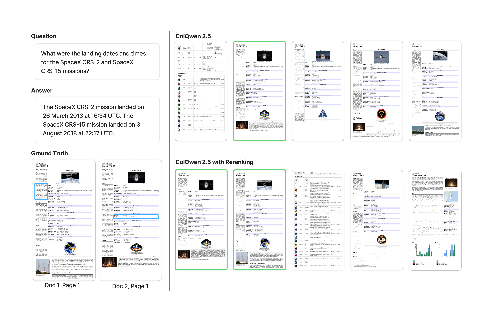
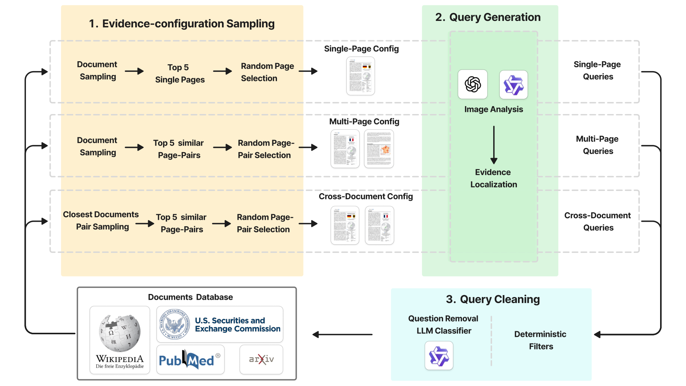

# VL-DocIR: A Benchmark for Vision-Based Long Document Information Retrieval

**NeurIPS 2026 · Evaluations & Datasets**

Simon Ott*, Yufan Chen*†, Ruiping Liu, Junwei Zheng, Jiale Wei, Di Wen, Kunyu Peng, Jiaming Zhang, Rainer Stiefelhagen

Karlsruhe Institute of Technology; Hunan University (Jiaming Zhang)

*Equal contribution. †Corresponding author: Yufan Chen.

[Paper](https://openreview.net/pdf?id=SxsberZw0W) · [OpenReview](https://openreview.net/forum?id=SxsberZw0W) · [Project page](https://yufanchen96.github.io/VL-DocIR/) · [Dataset](https://huggingface.co/datasets/anonymous-8421/VL-DocIR) · [Dataset files](https://huggingface.co/datasets/anonymous-8421/VL-DocIR/tree/main)

## Overview

Vision-based document retrieval has improved rapidly, but current evaluation settings still emphasize short documents and single relevant pages. This leaves an important gap between leaderboard performance and realistic long-document retrieval, where the evidence needed to answer a query may span multiple pages or even multiple documents. We present VL-DocIR, a page-level benchmark for evidence-complete visual long-document retrieval. VL-DocIR is built from 29,641 HTML-born documents rendered into 388,548 page images from Wikipedia, arXiv, PubMed, and SEC proxy statements. It contains 271,760 queries across 23 domains and six evidence structures, covering single-page, within-document multi-page, and cross-document evidence configurations. Evidence annotations are grounded to rendered pages and HTML element identifiers, and queries are filtered with a cleaning pipeline targeting clarity, correctness, closedness, and the absence of explicit layout references. We evaluate leading single-vector and multi-vector visual retrievers together with diagnostic retrieval settings such as document-context scoring, query splitting, reranking, and round-robin ensembles. The strongest evaluated configuration reaches 69.3 nDCGAll@10 and 80.6 RecallAll@10 under structure-balanced Macro evaluation, but source- and evidence-structure breakdowns show that cross-document retrieval remains substantially harder than single-page retrieval, and that document-context scoring is especially helpful for within-document multi-page queries. VL-DocIR exposes these failure modes and provides a more demanding target for visual long-document retrieval.

This repository contains the paper introduction, manuscript-result exports and static project page. The dataset and its documentation are hosted on Hugging Face.



*Original manuscript example: the question requires evidence pages from both SpaceX CRS-2 and CRS-15 documents. The figure compares ColQwen2.5 retrieval with reranking.*

## Task and corpus

A benchmark item contains a question `q`, its evidence-page set `E(q)` and the corpus `C`. A retriever receives the question and returns ranked page identifiers from the corpus. Evidence-complete retrieval requires every annotated evidence page to appear in the top-k results.

- **29,641 HTML-born documents**, rendered into **388,548 page images**.
- **271,760 queries** from **Wikipedia, arXiv, PubMed and SEC proxy statements**.
- **23 domains** and **six evidence structures**.
- Rendered page images retain figures, tables, formulas and document layout. HTML element identifiers and page-relative bounding boxes connect the evidence annotations to those images.

The same page-retrieval task permits visual, OCR-based, text-only and hybrid internal representations. Native HTML access in DOM-BM25 is reported explicitly as a source-text diagnostic.

## Evidence structures

| Evidence structure | Retrieval target | Queries | `question_type` |
|---|---|---:|---|
| Page-Single | One evidence on one page | 86,196 | `single-page_single-evidence` |
| Page-Multi | Multiple evidences on one page | 120,624 | `single-page_multi-evidence` |
| Doc-Adjacent | Adjacent pages in one document | 11,972 | `multi-page_connected` |
| Doc-Near | Nearby non-adjacent pages in one document | 3,392 | `multi-page_disconnected-close` |
| Doc-Far | Far-apart pages in one document | 2,563 | `multi-page_disconnected-distant` |
| Cross-Doc | Pages across different documents | 47,013 | `cross-document_same-type` |


The taxonomy separates page lookup from within-document and cross-document evidence retrieval. The query distribution is not uniform; structure-balanced Macro prevents the two large single-page groups from dominating the primary aggregate.

## Benchmark construction



1. **Document collection and rendering.** Source-specific collection creates broad domain coverage and related-document neighborhoods. HTML documents are rendered with headless Chrome/Playwright; element identifiers and bounding boxes support evidence alignment. Pages are 2000 × 4000 pixels, with boundary heuristics to reduce split content.
2. **Evidence-configuration sampling.** Visually rich pages and related page/document pairs define single-page, within-document and cross-document generation configurations.
3. **VLM query generation.** Models receive the selected page images and HTML with element identifiers, and produce questions, answers and evidence identifiers. Invalid generations are discarded.
4. **Query cleaning.** Filters target clarity, answer correctness or plausibility, closedness and the absence of explicit layout references. The dataset is reduced from 388,389 generated queries to 271,760 retained queries.

## Metrics and aggregation

Let `R_k(q)` be the set of retrieved top-k pages and `E(q)` the ground-truth evidence-page set.

```text
c_k(q)          = 1 if E(q) is a subset of R_k(q), otherwise 0
RecallAll@k(q)  = c_k(q)
nDCGAll@k(q)    = c_k(q) × nDCG@k(q)
```

Standard nDCG uses binary relevance for evidence pages. Standard Recall and nDCG remain useful diagnostics, but retrieving only part of an evidence set does not satisfy an evidence-complete query.

**Macro (primary)** averages the metric within each of the six evidence structures and then gives the six means equal weight. **Micro (secondary)** averages over all queries. Both are multiplied by 100 in the reported tables. The paper reports all four metrics at k = 3, 5 and 10. Source-averaged and domain-averaged Macro are additional diagnostics.

## Evaluated methods and retrieval settings

- **Single-vector visual retrievers:** GME Qwen2-VL and Jina v4 single-vector.
- **Multi-vector visual retrievers:** ColPali v1.3, ColQwen2.5, ColSmol 500, Jina v4 multi-vector, ColModernVBERT, ColNomic 7B and Tomoro ColQwen3.
- **Text baselines:** Tesseract 5.5.1 OCR with BM25; the same OCR text with untuned BGE-M3; native HTML text with DOM-BM25.
- **Diagnostic visual settings:** query splitting, document-context scoring, reranking of the top 25 candidates with Jina Reranker M0, and round-robin ensembles.
- **Hybrid settings:** ColNomic context or reranked lists combined with OCR-BM25 through equal-weight reciprocal rank fusion (constant 60, top-10 component lists). The three-list visual ensemble uses ordered round-robin fusion over reranked, context and base lists.

## Results

Representative complete-evidence results at k = 10 on the full 388,548-page corpus:

| Model / setting | Macro nDCGAll@10 | Macro RecallAll@10 | Micro nDCGAll@10 | Micro RecallAll@10 |
|---|---:|---:|---:|---:|
| ColQwen3 | 63.20 | 72.42 | 72.15 | 81.24 |
| ColNomic | 61.82 | 71.76 | 70.68 | 81.24 |
| ColNomic (Ctx) | 66.03 | 78.19 | 70.07 | 82.26 |
| ColNomic (Rerank) | 65.00 | 74.62 | 73.76 | 83.11 |
| ColNomic (Ensemble) | 69.28 | 80.64 | 75.64 | 86.23 |
| OCR-BM25 | 50.24 | 61.69 | 58.26 | 72.34 |
| OCR-dense (BGE-M3) | 19.35 | 24.70 | 23.86 | 31.12 |
| DOM-BM25 | 46.96 | 57.44 | 53.07 | 65.72 |
| Ctx + OCR-BM25 (RRF) | 65.13 | 78.67 | 69.75 | 84.24 |
| Rerank + OCR-BM25 (RRF) | 61.86 | 74.39 | 69.34 | 83.30 |


The strongest evaluated configuration reaches 69.28 nDCGAll@10 and 80.64 RecallAll@10 under Macro. OCR-BM25 reaches 61.69 Macro RecallAll@10. Combining it with ColNomic context retrieval raises complete-evidence recall from 78.19 to 78.67, while nDCGAll changes from 66.03 to 65.13. Cross-document retrieval remains a difficult regime.

[results.csv](results.csv) contains all 19 configurations from the current main-text table, with Macro and Micro values for all 12 metric/cutoff combinations. [results-provenance.json](results-provenance.json) identifies the manuscript table and source hash. These files transcribe the current paper results; they are not a newly executed evaluation or an independently reconstructed corrected-qrels release.

## Annotation validation and limitations

A stratified human audit covers all 24 source × evidence-structure cells with 800 entries: 50 Cross-Doc and 30 entries per other structure for each source. **746/800 entries are fully correct (93.25%; nominal 95% Wilson interval 91.3–94.8%)**. Cross-Doc correctness is **88.5%**, with 200 audited entries representing 199 unique queries.

The 54 issue entries comprise 13 query-formulation issues, 20 incorrect evidence sets, 17 unnecessary evidence-page sets and four non-presence queries without directly retrievable positive evidence. These are pre-adjudication audit proportions, rather than population-wide or post-correction accuracy estimates. The audit checks the supplied query–evidence pairs and does not enumerate every alternative valid evidence set in the full corpus.

The paper also examines page/element consistency for all 47,013 Cross-Doc queries and 100,504 evidence elements. Mechanical mapping flags and semantic annotation errors are distinct. The remaining scope limitations are VLM-generated queries, page-level evaluation and HTML-born documents; scanned and handwritten documents are outside the present corpus.

## Dataset access

Use the [Hugging Face dataset repository](https://huggingface.co/datasets/anonymous-8421/VL-DocIR) and [file tree](https://huggingface.co/datasets/anonymous-8421/VL-DocIR/tree/main) for the data. The current release requires a manual access request. Request access on the dataset page, then authenticate locally with `hf auth login`.

| File / directory | Contents |
|---|---|
| `questions.jsonl` | Query text, answers, evidence structure and generator metadata |
| `question_evidences.jsonl` | Evidence-page identifiers, element IDs and bounding boxes |
| `documents.jsonl` | Document source, domain, title, URL and license metadata |
| `document_pages.jsonl` | Page identifiers and page-shard references |
| `pages/` | Rendered page-image archives |
| `document_texts/` | Stored source HTML and element metadata |
| `VL-DocIR_croissant.json` | Machine-readable dataset metadata |


The Hub exposes `questions`, `question_evidences`, `documents` and `document_pages` as configurations, each with a split named `train`. This is a packaging label for the released collections, rather than a separate benchmark training partition.

Example using the inspected dataset revision:

```python
from datasets import load_dataset

questions = load_dataset(
    "anonymous-8421/VL-DocIR",
    "questions",
    split="train",
    revision="40a1818110c20e9279bbb4a3b6283ceac2d631ba",
    token=True,
)
```

The pinned revision is [`40a1818110c20e9279bbb4a3b6283ceac2d631ba`](https://huggingface.co/datasets/anonymous-8421/VL-DocIR/tree/40a1818110c20e9279bbb4a3b6283ceac2d631ba). The same configuration and split pattern applies to the other three JSONL collections. Consult the [versioned dataset card](https://huggingface.co/datasets/anonymous-8421/VL-DocIR/blob/40a1818110c20e9279bbb4a3b6283ceac2d631ba/README.md) for field definitions and the page archives for images; loading the questions collection does not download the page corpus.

### Linking questions, evidence and pages

- Join `questions.question_id` to `question_evidences.question_id`.
- Identify a page by the pair **`(document_id, page_number)`**; page numbers alone are not globally unique.
- Deduplicate evidence elements on the same page to obtain `E(q)` for page-level evaluation.
- Use `document_pages.page_shard_id` to find the rendered-page archive.
- Document source/domain/license metadata are in `documents`; source HTML and element metadata are under `document_texts/`.
- Answers, evidence identifiers and bounding boxes are ground-truth metadata; the retriever receives the query at evaluation.

### Licensing

The Hub dataset card licenses generated annotations and related metadata under CC BY 4.0. Underlying documents retain the source-specific licenses recorded in `documents.jsonl`; check those records when reusing source content. The website implementation license does not relicense the paper figures or underlying dataset documents.

## Citation

```bibtex
@inproceedings{ott2026vldocir,
  title     = {VL-DocIR: A Benchmark for Vision-Based Long Document Information Retrieval},
  author    = {Ott, Simon and Chen, Yufan and Liu, Ruiping and Zheng, Junwei and
               Wei, Jiale and Wen, Di and Peng, Kunyu and Zhang, Jiaming and
               Stiefelhagen, Rainer},
  booktitle = {Advances in Neural Information Processing Systems},
  year      = {2026},
  url       = {https://openreview.net/forum?id=SxsberZw0W}
}
```

## Contact

Simon Ott: [simon.ott@student.kit.edu](mailto:simon.ott@student.kit.edu)

Yufan Chen (corresponding author): [yufan.chen@kit.edu](mailto:yufan.chen@kit.edu)

## Project page

Static website source is in `docs/`. It uses the original manuscript figures and no generated artwork. Layout references: [Mip-NeRF](https://jonbarron.info/mipnerf/), [Nerfies](https://nerfies.github.io/) and [DreamFusion](https://dreamfusion3d.github.io/).

GitHub Pages deploys the `docs/` directory through the workflow in `.github/workflows/pages.yml`. To preview locally, run `python3 -m http.server --directory docs 8000` and visit `http://localhost:8000`.
